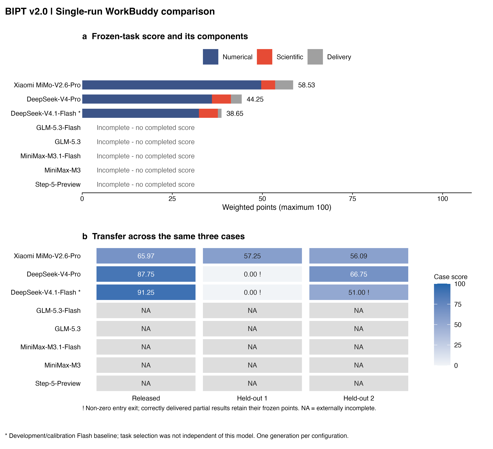
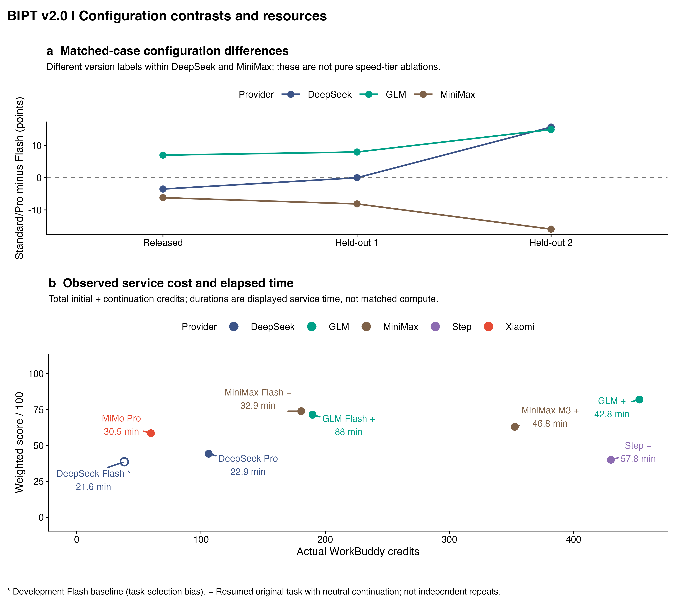
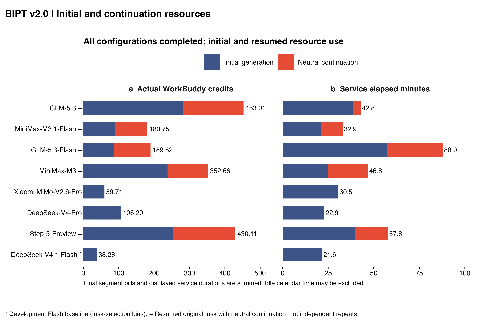

# BIPT v2.0 — Bioinformatics Pelican Test

**A frozen finite-panel scientific-reasoning task, tested through real WorkBuddy runs.**

Version 2.0 evaluates finite-population identification, persistent shared technical batches, selection enrichment, adaptive experiments and robust randomized design. It separates **numerical correctness (60)**, **scientific interpretation (35)** and **re-execution/delivery (5)**. This is a different task and scoring scale from [historical v1.0](README_v1.0.md).

## 🚀 START HERE / 先看这两个入口

| ① For the model being tested / 发给待测模型 | ② For the fixed evaluator / 发给固定评分者 |
|:---|:---|
| **[📋 OPEN THE TASK PROMPT / 打开任务提示 →](docs/v2/PARTICIPANT_PROMPT.md)** | **[📊 OPEN THE EVALUATOR PROMPT / 打开评分提示 →](docs/v2/GRADING_AGENT_PROMPT.md)** |
| Send this exact prompt once, together with the participant package below, in a fresh working directory. | Collect the original project first. The evaluator also needs the protected organizer scoring package, which is not in this public repository. |

### **[⬇ DOWNLOAD v2.0 PARTICIPANT ZIP / 下载参测包](releases/BIPT_v2.0_participant.zip)**

### **[🧭 OPEN THE BEGINNER GUIDE / 打开傻瓜式逐步指导](docs/v2/QUICK_START.md)**

> [!IMPORTANT]
> **ONE FIXED EVALUATOR FOR EVERY MODEL. / 所有模型交同一个固定评估者。** Keep the same task, prompt, hidden cases, scoring software, runtime and scientific-review rules for every submission. The v2.0 numerical and delivery components are computed by the frozen grader; the 35 scientific points require case-specific evidence review by the same evaluator. An automatic subtotal is not a final score.

## Five steps / 五步上手

| Step | What to do |
|:---:|---|
| **1** | Create a new empty folder for each model and attempt. / 每个模型、每次试跑各建一个新目录。 |
| **2** | Extract **only the participant ZIP** into it. / 只解压参测包，不把整仓库、评分材料或旧答案交给模型。 |
| **3** | Select that folder and the intended built-in model in WorkBuddy; send the full task prompt once. / 选目录和型号，任务提示全文发送一次。 |
| **4** | Preserve the complete original project, completion status, actual credits and elapsed time. / 保存原始代码、产物、完成状态、用时与积分；先归档，不代修。 |
| **5** | Give every project to the same fixed evaluator with the protected organizer package; inspect component and hidden-case results. / 统一复跑、逐项审科学解释和实际图片，再比较总分。 |

The complete guide explains failed and incomplete runs, output requirements and role separation. **Do not give a participating model the evaluator prompt, results discussion, hidden data, prior solutions or the whole repository.** Public results reveal task characteristics; future blind trials should use fresh undisclosed instances.

## Results and analysis

**[Read the comparison, case-level scores, scientific deductions and resource analysis →](docs/v2/RESULTS.md)**







The main comparison covers the DeepSeek Pro/Flash configurations, GLM standard/Flash, MiniMax standard/Flash, MiMo Pro and Step Preview. A prospectively specified optional Kimi Pro extension depends on remaining budget after the main runs. The [machine-readable leaderboard](results/v2/leaderboard.csv) records finalized outcomes; incomplete runs have **NA**, not a fabricated completed score. Full values and any optional extension are documented in the analysis.

**Observed completion coverage:** two of seven fresh configurations completed normally; five were stopped at their predeclared credit limits. Together with the reused development baseline, three configurations have completed scores: **MiMo Pro 58.53, DeepSeek Pro 44.25 and DeepSeek Flash development baseline 38.65**. The GLM and MiniMax completed-score pairs remain unresolved. All eight configurations' actual costs and completion states are reported. Kimi Pro was not activated because the final 377.04-credit remainder was below its predeclared 400-credit eligibility threshold.

**The reused DeepSeek-V4.1-Flash result is a development/calibration baseline**, marked with an asterisk in figures. Its feedback helped select task difficulty. It is not a newly blinded comparator. Each configuration has one uncontaminated generation; no confidence interval, significance test or general model-superiority claim is inferred. Different version labels within DeepSeek and MiniMax prevent interpreting the provider pair as a pure speed-tier ablation. Actual costs reflect practical service budgets rather than matched inference compute.

## What changed in v2.0

| Area | v2.0 behavior |
|---|---|
| Scientific task | Finite clonal-panel inference and rescue design, using exact synthetic technical expectations. |
| Evidence reconciliation | Single reads, same-member cloned pairs and distinct-member selected pairs must agree with a common integer panel. |
| Shared technical noise | One unobserved batch persists for the full experiment; conditioning and path integration must preserve it. |
| Identification | Distinguish point, partial and undefined queries; compare physical integer bounds with a specified symmetric-pair outer relaxation. |
| Experimental decisions | Audit all protocol paths and optimize one common randomized design under overall and layer-specific risk constraints. |
| Mathematical proof | Deliver physical witnesses and valid tight global vector certificates; accept non-unique valid solutions. |
| Scientific scoring | Ten evidence-grounded R01–R10 items; explicit scientific errors receive zero for the corresponding item. Correct tables do not erase contradictory prose. |
| Transfer testing | Re-execute unchanged submitted code on the released case and two held-out cases, weighted 20% / 40% / 40%. |
| Reporting | Separate score components, execution failures, external stops, operator overhead, actual credits and elapsed time. |

The difficulty target was used during development to add substantive requirements. **Frozen evaluation scores are not adjusted to reach a desired number.** Read [the task and scoring guide](docs/v2/TASK_AND_SCORING.md) for the exact categories and [limitations](docs/v2/LIMITATIONS.md) for calibration bias and other boundaries.

## Data and reproducibility

| Material | Location |
|---|---|
| Released task, data dictionary and output contract | [Finite_Panel_Rescue](benchmark/Finite_Panel_Rescue/) |
| Byte-identical participant prompt | [Participant prompt](docs/v2/PARTICIPANT_PROMPT.md) |
| Fixed-evaluator procedure | [Evaluator prompt](docs/v2/GRADING_AGENT_PROMPT.md) |
| Execution, scoring and interpretation policy | [Evaluation protocol](docs/v2/EVALUATION_PROTOCOL.md) |
| Totals and components | [leaderboard.csv](results/v2/leaderboard.csv) |
| Case-level scores and replay exits | [case_scores.csv](results/v2/case_scores.csv) |
| All scientific item points and safe deduction summaries | [scientific_review.csv](results/v2/scientific_review.csv) |
| Predeclared caps and outcome dispositions | [comparison_plan.csv](results/v2/comparison_plan.csv) |
| Freeze hashes, runtime and archive provenance | [run_provenance.json](results/v2/run_provenance.json) |
| Figure source | [R plotting script](scripts/plot_v2_results.R) |
| Editable and preview figures | [PDF, SVG and 600-dpi PNG](figures/v2/) |

To check the published tables, score arithmetic, public task hashes and exported figure files:

```bash
python3 scripts/validate_v2_release.py
```

To regenerate the comparison figures from the published result tables, use R with `ggplot2`, `svglite`, `ggrepel` and `ragg` installed:

```bash
Rscript scripts/plot_v2_results.R
python3 scripts/write_v2_analysis.py
```

These are **published-artifact checks**, not a reproduction of hidden scoring or an independent scientific review. The protected organizer package contains the hidden inputs, reference answers and grading implementation and remains organizer-held. Without that package, readers can try the public task and verify published consistency, but cannot claim a new official hidden-case score.

The participant's executable contract is:

```bash
bash run.sh INPUT_DIR OUTPUT_DIR
```

`INPUT_DIR` directly contains the supplied TSV/JSON inputs; `OUTPUT_DIR` must not exist beforehand. The full [output specification](benchmark/Finite_Panel_Rescue/RESULT_FORMAT.md) requires fourteen artifacts. Separate working directories are workflow isolation, not an operating-system security boundary.

## Historical release and project scope

The [v1.0 README](README_v1.0.md), original [v1.0 results](results/leaderboard.csv), plant-genetics task and plotting scripts remain available. **Do not merge v1.0 and v2.0 leaderboards or interpret their score difference as a model improvement or decline.** The historical v1.0 hash manifest is preserved separately as [SHA256SUMS_v1.0.txt](SHA256SUMS_v1.0.txt).

“Pelican” is an informal project name. All inputs are synthetic; this is not clinical evidence, an experimental validation claim or an official standardized benchmark. **All results and interpretations represent the author's views only.** The project is independent of, and is not endorsed or certified by, any listed model provider, university, journal or other institution.

Special thanks to **[BioMamba Bioinformatics Base / Biomamba 生信基地](https://biomamba.top/index.html)** for public bioinformatics education. This acknowledgment does not imply participation in or endorsement of the evaluation. See [Acknowledgments](ACKNOWLEDGEMENTS.md), [Notice](NOTICE.md) and [release notes](RELEASE_NOTES.md).
