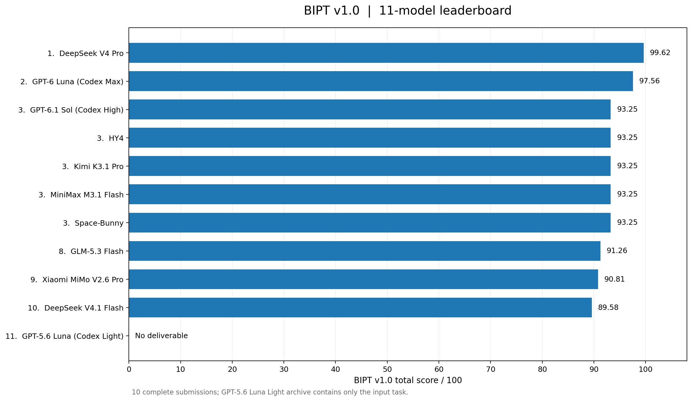
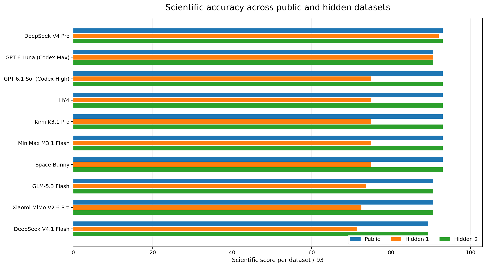

# BIPT v1.0 — Bioinformatics Pelican Test

**An author-led, reproducible stress test for AI agents conducting bioinformatics research**  
*Retrospective evaluation: 11 submitted configurations · 10 valid submissions · 1 synthetic plant-genetics task · 100-point automatic rubric*

> [!IMPORTANT]
> **Author's views disclaimer:** All scores, rankings, conclusions, and interpretations reported here **represent the author's views only**. BIPT is an **independent evaluation** and is **not an official judgment, endorsement, or certification** by any model provider, university, journal, or other organization. A score on one synthetic task is **not a general measure** of scientific or bioinformatics ability.

> [!WARNING]
> **Benchmark disclosure:** The v1.0 round is complete. The public repository contains the task and historical results. The optional *full reproducibility archive* contains the v1.0 hidden-instance generation and scoring source; **publishing that archive retires v1.0 for future blind tests**. Do not distribute the organizer archive to models participating in an ongoing evaluation.

> [!NOTE]
> **Special thanks to [BioMamba Bioinformatics Base (Biomamba 生信基地)](https://biomamba.top/index.html).** We appreciate its public bioinformatics tutorials, educational outreach, and efforts to make practical bioinformatics methods accessible to the research community. This is an **acknowledgment of educational inspiration**, not a claim that BioMamba designed, conducted, funded, reviewed, or endorsed this evaluation. See [Acknowledgments](ACKNOWLEDGEMENTS.md).

## At a glance

| Property | BIPT v1.0 |
|---|---|
| Purpose | Test **biological reasoning**, variant analysis, statistical independence, and the reproducibility of AI-generated pipelines |
| Task | Prioritize a candidate locus for a synthetic pale-leaf phenotype using **FASTA + GFF3 + VCF + phenotype data** |
| Domain | Diploid plant genetics; **not oncology, clinical diagnosis, or real experimental samples** |
| Design | A naturalistic research request with **no explicit list of hidden failure modes** |
| Time budget | **30 minutes per agent**, planned as an externally controlled wall-clock limit; complete per-run time logs were not archived for this report |
| Scoring | **100 points**; fixed, deterministic Python rubric; **no second AI judge and no manual image aesthetics scoring** |
| Evaluation | One released dataset plus **two held-out generated instances**, all requiring pipeline re-execution |
| Submissions | 11 archives supplied; **10 executable**, 1 lacked an analysis deliverable |
| Reproduction | Historical scores, input data, scripts for checking published artifacts; full scoring source supplied separately for controlled disclosure |

**Why 'Pelican'?** The name denotes an intentionally challenging, multi-layered scientific task rather than a standard programming quiz. It is an informal project name, **not a claim of official benchmark standardization**.

## Results — historical BIPT v1.0 round



The ranking below reports **observed rule-based scores** from a single historical task. Labels and reasoning settings were supplied for the submitted configurations; their upstream provenance and provider-reported version metadata were **not independently certified**.

| Rank | Submitted configuration | Reported reasoning setting | BIPT v1.0 score |
|---:|---|---|---:|
| **1** | **DeepSeek V4 Pro** | Ultra-high | **99.62** |
| **2** | **GPT-6 Luna (Codex Max)** | Max | **97.56** |
| 3 = | MiniMax M3.1 Flash | Extreme | 93.25 |
| 3 = | HY4 | High | 93.25 |
| 3 = | Space-Bunny | Extreme | 93.25 |
| 3 = | Kimi K3.1 Pro | Extreme | 93.25 |
| 3 = | GPT-6.1 Sol (Codex High) | High | 93.25 |
| 8 | GLM-5.3 Flash | Extreme | 91.26 |
| 9 | Xiaomi MiMo V2.6 Pro | Default | 90.81 |
| 10 | DeepSeek V4.1 Flash | Extreme | 89.58 |
| — | GPT-5.6 Luna (Codex Light) | Light | **N/A — missing analysis deliverable** |

> [!NOTE]
> The automated scoring software records **0.00** for an archive without the required analysis entry point. For publication this is marked **N/A**, since **missing deliverable ≠ measured zero scientific capability**. Scores are not normalized for inference budget, computational expense, hardware, or independently measured time.

The **10 valid submissions** scored between **89.58 and 99.62** (mean **93.51**, median **93.25**, population SD **2.86**). Their relatively high scores suggest a **ceiling effect** on several routine annotation and delivery checks. **Eight of ten** selected a different top locus than the scorer in *held-out instance 1*. This one criterion accounts for a substantial part of the observed separation.



**Read the interpretation before using this ranking:**
- **DeepSeek V4 Pro** ranked first **under the frozen BIPT v1.0 rubric**; **GPT-6 Luna (Codex Max)** ranked second.
- **All ten valid submissions re-executed successfully** on the released and both held-out instances in the final scoring environment.
- The reference ranking rule prefers **more pale-phenotype accessions with predicted biallelic disruption**, then **fewer green controls with biallelic disruption**. Alternative candidate-ranking priorities, especially a stronger penalty for affected controls, can be scientifically defensible. This **limits the interpretation of the first-place margin**.
- Image scoring checks **file existence, PNG integrity, resolution, and nonempty content**, *not* plotting correctness or human aesthetics.
- No uncertainty interval over independent repetitions is estimated; the results **should not be treated as statistically established model superiority**.

**More detail:** [full results and score decomposition](docs/RESULTS.md) · [limitations](docs/LIMITATIONS.md) · [machine-readable leaderboard](results/leaderboard.csv) · [per-model aggregate JSON](results/score_details.json).

## The scientific task

The agent receives a concise research request about pale versus green leaves in a synthetic diploid model plant. The data consist of candidate genomic regions, transcript annotations, cohort variants, and phenotype measurements. It must identify plausible disruptive alleles and use their **phased haplotype configurations** and **segregation across independent accessions** to prioritize a locus for subsequent validation.

**The prompt intentionally does not name each of the technical pitfalls.** Its fixed deliverables are required for automatic evaluation, but the candidate is expected to choose and implement a scientifically sound analysis pipeline.

| Input | Meaning |
|---|---|
| `draft_reference.fa` | Candidate-region nucleotide sequences |
| `genes.gff3` | Transcript-specific coding segments, coordinates, phase, and strand |
| `gene_catalog.tsv` | Functional descriptions and primary / alternative transcript IDs |
| `cohort_variants.vcf` | Variants, ALT alleles, genotype phase, depth/quality, and site filters |
| `phenotypes.tsv` | Leaf pigment measurements, visual phenotype class, technical repeats |

An [English translation of the original task](benchmark/Leaf_Pigment_Genetics/README_EN.md) is included for readers. **Historical replay should use the original Chinese participant-facing files**, not the translated versions.

The released synthetic input has **14 candidate genes, 71 VCF records (72 ALT alleles), 20 independent accessions and 40 phenotype measurements**. **Technical repeat measurements do not create additional independent accessions.**

### Common failure modes intentionally tested

| Failure mode | Consequence of an incorrect pipeline |
|---|---|
| VCF 1-based positions / GFF3 coordinates | Mislocated coding variants; incorrect predicted amino-acid consequences |
| Negative-strand transcript reconstruction | Incorrect codons, start/stop annotations, and inferred loss of function |
| Multiple isoforms and CDS phase | A consequence on a secondary isoform incorrectly treated as primary-transcript disruption |
| Multiallelic `ALT` records | `1|2` mistakenly interpreted as two copies of the same ALT |
| Phased heterozygous variants | **Cis** (`0|1` + `0|1`) mistakenly called **trans** (`0|1` + `1|0`) |
| `FILTER=PASS` with REF mismatch | A reference-inconsistent VCF record falsely accepted |
| Low DP/GQ | Unreliable genotypes counted as strong segregation support |
| Repeated phenotype measurements | Technical replicates counted as extra biological accessions |
| Gene function narratives | A plausible-sounding annotation used instead of genotype and segregation evidence |
| Correlation versus causality | Predicted variant effects treated as experimental confirmation of a causal gene |

These are **standards-derived failure categories**, not a claim that any named model makes each mistake frequently. Supporting sources are collected in [technical references](docs/REFERENCES.md).

## Methodology and scoring

The score is **not generated by an LLM**. A deterministic grader runs each submitted analysis code on the same released input and two hidden instances, compares its tabular and JSON output with generator-derived reference results, and aggregates points under a frozen rubric.

**Scientific checks: 93 points per dataset.**

| Category | Maximum points per dataset |
|---|---:|
| Transcript-specific consequences for key variants | 22 |
| Consequences for remaining variants | 13 |
| REF validation and low-quality site handling | 7 |
| Genotype QC and independent high-confidence carrier counts | 6 |
| Phased primary-candidate haplotype burden | 13 |
| Cis-decoy haplotype handling | 7 |
| Background-gene burden | 3 |
| Candidate-gene priority and supporting alleles | 14 |
| Interpretation, sample independence, and causal-evidence boundary | 8 |
| **Science subtotal** | **93** |

The grader combines the three science scores as

$$
\text{Total}=0.25S_{\text{released}}+0.375S_{\text{held-out 1}}+0.375S_{\text{held-out 2}}+R+A
$$

where `S` is scored out of 93, `R` is **hidden re-execution (0–4)**, and `A` is **artifact integrity (0–3)**. The maximum total is **100**. Explicitly unsupported causal certainty and repeated top-candidate failures may activate **predeclared score caps**; see [scoring methodology](docs/SCORING.md).

> [!IMPORTANT]
> **Scientific quality takes priority over presentation.** The grade intentionally focuses on sequence interpretation and evidence reconciliation. Only **3/100 points** measure file/figure delivery integrity, and **none** constitute a subjective visual-design rating.

## How to run the supplied research task

Download or clone the repository. The input task is under:

`benchmark/Leaf_Pigment_Genetics/`

Give only that directory, with its original `PROJECT_REQUEST.md`, to an analysis agent. The required program contract is:

```bash
bash run.sh /absolute/path/to/benchmark/Leaf_Pigment_Genetics/data /absolute/path/to/output
```

Expected output files:

```text
output/
├── variant_consequences.tsv
├── variant_qc.tsv
├── accession_gene_burden.tsv
├── summary.json
├── segregation.png
└── interpretation.md
```

The `run.sh` should be portable across new input instances and must **not** rely on memorized gene IDs, sample IDs, or reference answers. Models should receive **identical prompts, permissions, software resources, and execution time**, and must be prevented from reading other submissions or the organizer scorer.

> [!CAUTION]
> **Do not run untrusted AI-generated shell scripts directly on your personal machine.** Use an isolated container/VM, no network, read-only input, restricted privileges, and separate writable output. The scoring source is distributed in a **separate retrospective archive**, not in this blind-safe GitHub publication package.

For scoring execution, hidden-instance generation, and repository archive options, see [evaluation protocol](docs/EVALUATION_PROTOCOL.md) and [reproducibility](docs/REPRODUCIBILITY.md).

## Repository contents

```text
BIPT_v1_GitHub_Release/
├── README.md                     # This page; method and results
├── NOTICE.md                     # Independence and author's-views disclaimer
├── ACKNOWLEDGEMENTS.md           # BioMamba acknowledgment and no-endorsement clarification
├── benchmark/
│   └── Leaf_Pigment_Genetics/   # Original v1.0 task and synthetic input files
├── docs/
│   ├── BENCHMARK_DESIGN.md       # Biological and computational challenge
│   ├── SCORING.md                # Exact point composition and score caps
│   ├── EVALUATION_PROTOCOL.md    # Running agents and isolated scoring
│   ├── REPRODUCIBILITY.md        # What can and cannot be independently repeated
│   ├── RESULTS.md                # Interpretive analysis of all 11 archives
│   ├── LIMITATIONS.md            # Caveats and disputed answer definition
│   ├── REFERENCES.md             # Github/format-specification source links
│   ├── PUBLISHING.md             # How to make a GitHub repository
│   └── CITATION_AND_LICENSE.md   # Publication checklist and citation template
├── results/
│   ├── leaderboard.csv
│   ├── score_details.json
│   └── submission_manifest.csv
├── figures/
│   ├── leaderboard.png
│   └── public_vs_hidden.png
├── scripts/
│   ├── validate_release.py
│   └── plot_results.py
└── .github/workflows/validate-release.yml
```

**The 11 agents' raw code submissions are not included in this public package.** Historical agent-level replay requires the original submission archives, which remain external to this release; the CSV/JSON files preserve the reported outputs and grading metadata.

## Interpretation and responsible use

**BIPT v1.0 is one task, one synthetic generator family, and one completed comparison.** It does **not** establish comparative accuracy on medical data, single-cell RNA-seq, proteomics, or real clinical workflows. The scores are sensitive to a preselected candidate-ranking criterion. A new benchmark version should use new held-out tasks, realistic uncertain outcomes, and advance-registered answer acceptability criteria.

- The numerical scores are **reproducible within the reported rubric**, conditional on the original submissions, environment, and held-out seeds.
- The **interpretation and ranking claims represent the author's views only** and are **not official assessments** of the listed models.
- The dataset is **synthetic**, and predicted disruption is **not proof of a causal biological mechanism**.
- Differences in reasoning modes, adapters, model settings, and computational budgets remain potentially confounded.

**Further reading:** [results](docs/RESULTS.md) · [methods](docs/BENCHMARK_DESIGN.md) · [limitations](docs/LIMITATIONS.md) · [project notice](NOTICE.md).

## Acknowledgments

**Special thanks to [BioMamba Bioinformatics Base (Biomamba 生信基地)](https://biomamba.top/index.html)** for its contributions to bioinformatics education, practical tutorials, and open knowledge-sharing in the research community. This recognition is solely an acknowledgment of educational resources and inspiration; **BioMamba is not claimed to have participated in the benchmark or endorsed these rankings**. See [ACKNOWLEDGEMENTS.md](ACKNOWLEDGEMENTS.md).

## Attribution, license, and contact

This is an **independent author-led repository**. Its author may provide a preferred name, affiliation, contact, publication DOI, and license before release. **No formal journal peer review or DOI is claimed** by this draft. The project and model names are used for identification only; see [NOTICE](NOTICE.md). Before publishing, review the [citation and licensing checklist](docs/CITATION_AND_LICENSE.md).

> **Disclaimer (required): The results and interpretations presented here reflect only the author's views. They are not endorsed by, and do not represent the official views of, any AI model developer, company, institution, or other organization.**