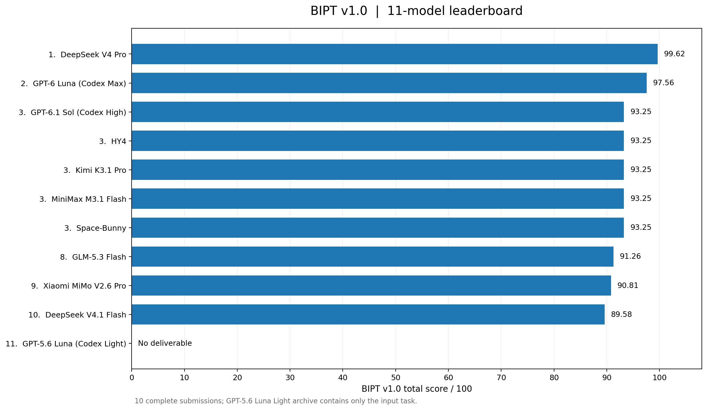
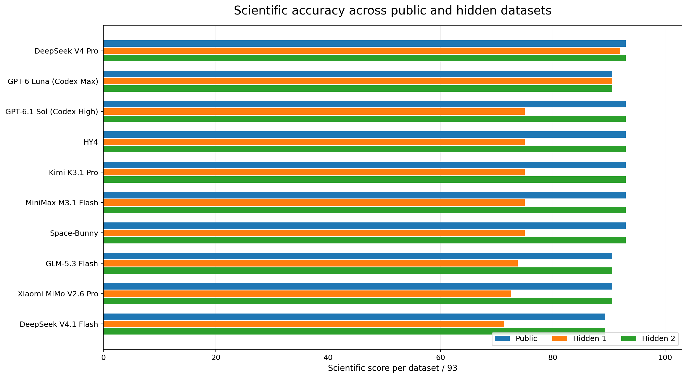

# BIPT v1.0 results — 11 submitted model configurations

> [!IMPORTANT]
> **Results and interpretations are the author's views only.** This is an independent single-task comparison, **not** an official ranking, vendor certification, a statistically replicated superiority claim, or a measurement of all bioinformatics capabilities.

## Executive summary

- **11 submission archives** were received; **10 included a valid runnable pipeline** and **1 contained no analysis deliverable**.
- The ten valid pipelines were rerun on **the public dataset and two generated held-out datasets**.
- **DeepSeek V4 Pro** ranked first with **99.62/100**; **GPT-6 Luna (Codex Max)** ranked second with **97.56/100** under the frozen v1.0 rubric.
- **Five models tied at 93.25**. The high concentration of scores indicates that the task still has a **ceiling effect** for common sequence annotation and delivery checks.
- **Eight of ten valid candidates** did not select the scorer's preferred top gene for **held-out instance 1**. This explains much of the ranking separation and exposes a **reference-answer ambiguity** that must be considered when interpreting the leader.
- The **10 valid submissions** had an average of **93.51**, median **93.25**, population standard deviation **2.86** and range **89.58–99.62**.

## Overall scores

| Rank | Model / mode as submitted | Overall score | Released /93 | Held-out 1 /93 | Held-out 2 /93 | Replay |
|---:|---|---:|---:|---:|---:|---|
| **1** | **DeepSeek V4 Pro — Ultra-high** | **99.62** | 93.00 | 92.00 | 93.00 | Passed all 3 |
| **2** | **GPT-6 Luna — Codex Max** | **97.56** | 90.56 | 90.56 | 90.56 | Passed all 3 |
| **3 =** | MiniMax M3.1 Flash — Extreme | 93.25 | 93.00 | 75.00 | 93.00 | Passed all 3 |
| **3 =** | HY4 — High | 93.25 | 93.00 | 75.00 | 93.00 | Passed all 3 |
| **3 =** | Space-Bunny — Extreme | 93.25 | 93.00 | 75.00 | 93.00 | Passed all 3 |
| **3 =** | Kimi K3.1 Pro — Extreme | 93.25 | 93.00 | 75.00 | 93.00 | Passed all 3 |
| **3 =** | GPT-6.1 Sol — Codex High | 93.25 | 93.00 | 75.00 | 93.00 | Passed all 3 |
| 8 | GLM-5.3 Flash — Extreme | 91.26 | 90.56 | 73.78 | 90.56 | Passed all 3 |
| 9 | Xiaomi MiMo V2.6 Pro — Default | 90.81 | 90.56 | 72.56 | 90.56 | Passed all 3 |
| 10 | DeepSeek V4.1 Flash — Extreme | 89.58 | 89.33 | 71.33 | 89.33 | Passed all 3 |
| — | GPT-5.6 Luna — Codex Light | **N/A** | — | — | — | **Missing deliverable** |

**Missing delivery:** The eleventh archive contained the research task materials, but no runnable model analysis or required results. The original scorer stores 0.00 under its no-deliverable policy, but **N/A** is the correct *interpretation* in a public comparison. It must **not** be construed as an observed absence of scientific ability.

> [!NOTE]
> The model strings and reasoning settings reproduce the **user-supplied submission labels**. This repository does not certify their upstream release versions, token budgets, inference endpoints, or commercial relationships.

## Released vs held-out performance

This figure displays **scientific accuracy only** (maximum 93 per instance). A model may have an identical public score and held-out 2 score but lose points on held-out 1 if the preferred candidate locus changes.

**Interpretation:** A pipeline that can correctly parse a VCF, infer a phased burden, and complete its output schema can still use a different **prioritization strategy** when multiple candidates have competing types of support. Thus, this figure should not be interpreted as showing an equally large difference in every component of bioinformatics ability.

## Score decomposition by evaluated skill

The table below contains **weighted contributions to the 100-point score**. Categories are weighted over the three data instances, and are **not** the raw 93-point figure values in the preceding table.

| Model | Annotation /35 | QC /13 | Haplotype /23 | Candidate /14 | Interpretation /8 | Replay /4 | Integrity /3 |
|---|---:|---:|---:|---:|---:|---:|---:|
| DeepSeek V4 Pro | 35.00 | 13.00 | 23.00 | 14.00 | 7.63 | 4.00 | 3.00 |
| GPT-6 Luna Max | 32.56 | 13.00 | 23.00 | 14.00 | 8.00 | 4.00 | 3.00 |
| MiniMax M3.1 Flash | 35.00 | 13.00 | 23.00 | 8.75 | 6.50 | 4.00 | 3.00 |
| HY4 | 35.00 | 13.00 | 23.00 | 8.75 | 6.50 | 4.00 | 3.00 |
| Space-Bunny | 35.00 | 13.00 | 23.00 | 8.75 | 6.50 | 4.00 | 3.00 |
| Kimi K3.1 Pro | 35.00 | 13.00 | 23.00 | 8.75 | 6.50 | 4.00 | 3.00 |
| GPT-6.1 Sol High | 35.00 | 13.00 | 23.00 | 8.75 | 6.50 | 4.00 | 3.00 |
| GLM-5.3 Flash | 33.01 | 13.00 | 23.00 | 8.75 | 6.50 | 4.00 | 3.00 |
| Xiaomi MiMo V2.6 Pro | 32.56 | 13.00 | 23.00 | 8.75 | 6.50 | 4.00 | 3.00 |
| DeepSeek V4.1 Flash | 31.33 | 13.00 | 23.00 | 8.75 | 6.50 | 4.00 | 3.00 |

> [!TIP]
> The sum of the published **rounded** category values may differ from the reported final score by **0.01** due to rounding. The canonical values are `results/score_details.json` and `results/leaderboard.csv`.

### First place: DeepSeek V4 Pro

**Strength within the rubric:** 35/35 on variant annotation, 13/13 on QC, 23/23 on phased burden, and **14/14 on priority identification**. The only observed aggregate deductions were in the interpretation category. It matched the scorer's primary candidate on all three instances.

**What it does not establish:** A stronger score on this one synthetic genetics task does not establish superior outcomes in real ecological, cancer, transcriptomic, or clinical analyses.

### Second place: GPT-6 Luna (Codex Max)

This configuration selected the scorer's top candidate on all three instances and earned full QC, phased burden, and interpretation credit. It lost weighted points in **transcript-specific variant consequence annotation**, causing its total of **97.56**.

### Five configurations tied at 93.25

MiniMax, HY4, Space-Bunny, Kimi, and GPT-6.1 Sol each obtained full annotation, QC, and phased-burden contributions; the common error under the frozen rubric was the **held-out 1 top gene**. Their scores were identical, and there is **no basis in this experiment to order the five within the tie**.

### Remaining valid configurations

GLM-5.3 Flash, Xiaomi MiMo V2.6 Pro, and DeepSeek V4.1 Flash also selected a different top candidate in held-out 1 and additionally missed some critical per-transcript consequence labels, producing **91.26**, **90.81**, and **89.58**, respectively.

## Why held-out instance 1 is a critical limitation

The reference implementation ranks by **number of affected (`pale`) accessions with predicted biallelic disruption** before considering **affected-control specificity**. Some alternative submitted pipelines were more conservative about genes displaying disruption in unaffected (`green`) accessions and favored another locus.

**This is a genuine methodological choice**: a strict count-first scoring oracle produces deterministic evaluation, but not necessarily the only plausible biological candidate choice. The observed eight-model drop on held-out 1 therefore should be described as **disagreement with the scorer's ranking criterion**, not automatically as eight independent demonstrations of scientific incompetence.

To resolve this in a new evaluation, define **acceptable alternative candidate outcomes** prospectively and score agreement with multiple biological objectives rather than a single hard-coded top gene. Re-scoring only models that disagree with an author's preferred interpretation would introduce bias.

## Robustness and generalization limits

- Ten valid model-generated source pipelines successfully executed on each of the three grading instances, showing **code portability within this synthetic generator family**.
- Their high scores are compatible with many ordinary sequence-analysis operations being tractable for all ten systems.
- No multiple-seed replication per model, confidence interval, significance test of between-model score gaps, or calibration against expert biologists was included in the historical study.
- Different reasoning settings and agent wrappers may affect results independently of base model quality.
- **Raw agent sessions and timestamps are not preserved**, so no audited model speed or cost leaderboard can be produced from this release.

**Bottom line:** The reproducible rule-based result favors DeepSeek V4 Pro and GPT-6 Luna Max in this specific benchmark, while the overall high scores and contested candidate rule limit the strength of any broader claim.

## Data downloads

- [`leaderboard.csv`](../results/leaderboard.csv) — original ranks, mode labels, science by instance, and weighted categories.
- [`score_details.json`](../results/score_details.json) — machine-readable aggregate evaluation and grader hashes.
- [`submission_manifest.csv`](../results/submission_manifest.csv) — archived source ZIP names and their status.
- [Evaluation protocol](EVALUATION_PROTOCOL.md) — how the three-instance score is computed.

> **Author's statement:** All views expressed in this report, including which comparisons are meaningful and how much weight should be given to the scores, are **the author's views only**.
