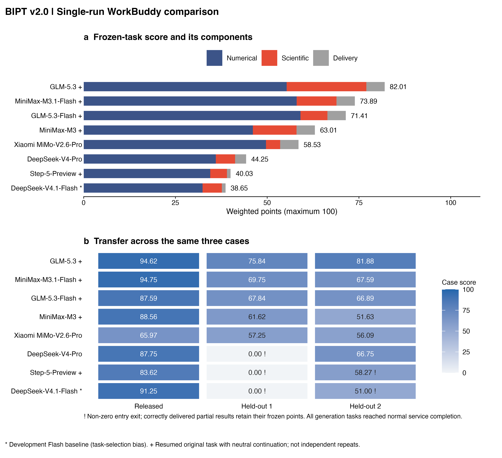
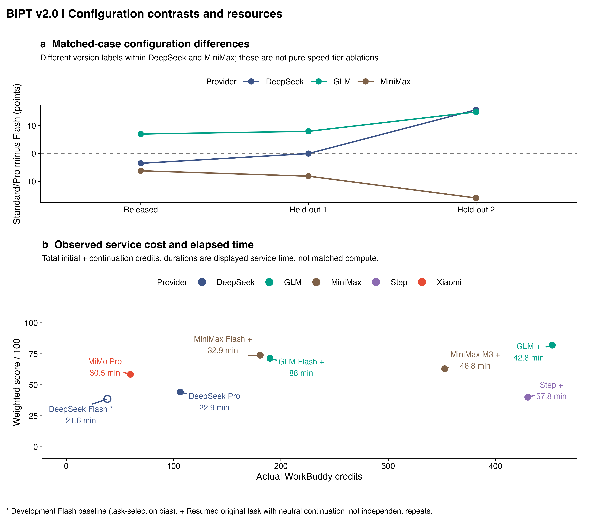
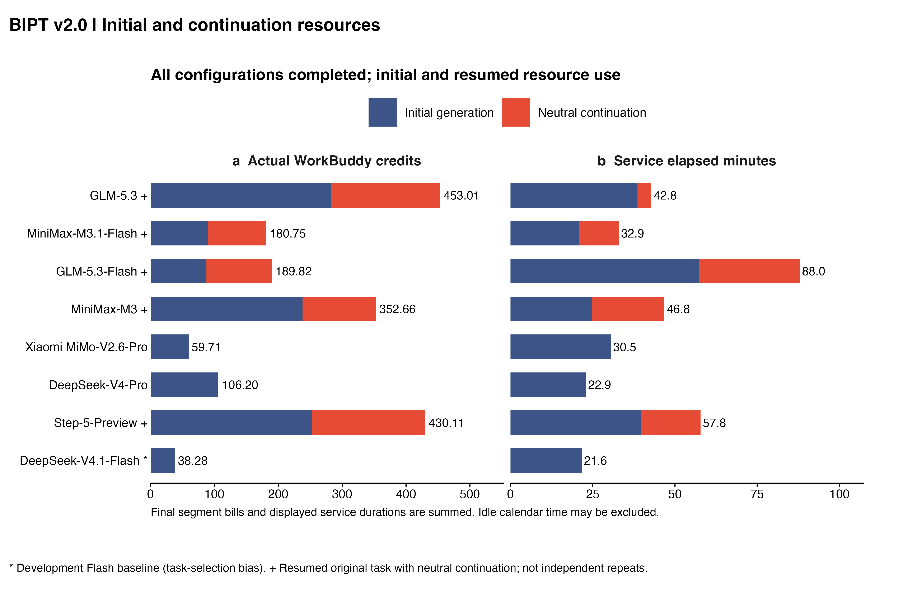

> Historical capped-phase report. Five externally stopped tasks were subsequently completed; see [the final comparison](RESULTS.md). Figures below refer to the frozen initial publication.

# BIPT v2.0 — observed results and interpretation

The released dataset contains 8 finalized configurations: 3 completed scored submissions and 5 externally incomplete submissions. One uncontaminated generation was collected per configuration. The DeepSeek Flash development baseline is reused and marked with an asterisk; it is not a newly blinded run.

**These are exact single-run observations on a selected synthetic task, not a statistically established general model ranking.** Version 1.0 scores use a different task and scale and are excluded.

## Scores and case transfer

| Configuration | Total / 100 | Numerical / 60 | Scientific / 35 | Delivery / 5 | Released | Held-out 1 | Held-out 2 |
|---|---:|---:|---:|---:|---:|---:|---:|
| Xiaomi MiMo-V2.6-Pro | 58.53 | 49.68 | 3.85 | 5.00 | 65.97 | 57.25 | 56.09 |
| DeepSeek-V4-Pro | 44.25 | 36.00 | 5.25 | 3.00 | 87.75 | 0.00 | 66.75 |
| DeepSeek-V4.1-Flash * | 38.65 | 32.40 | 5.25 | 1.00 | 91.25 | 0.00 | 51.00 |
| GLM-5.3-Flash (incomplete_settled) | NA | NA | NA | NA | NA | NA | NA |
| GLM-5.3 (incomplete_settled) | NA | NA | NA | NA | NA | NA | NA |
| MiniMax-M3.1-Flash (incomplete_settled) | NA | NA | NA | NA | NA | NA | NA |
| MiniMax-M3 (incomplete_settled) | NA | NA | NA | NA | NA | NA | NA |
| Step-5-Preview (incomplete_settled) | NA | NA | NA | NA | NA | NA | NA |

Case totals are unweighted 100-point case scores; component columns are weighted across cases. The final total uses 20% released and 40% for each held-out case. NA means externally incomplete, not zero capability. A normal service completion can still fail a hidden replay and receive its actual frozen artifact points.

**Completion coverage:** only 2 of the seven fresh configurations reached normal service completion within their predeclared limits. The five externally stopped configurations do not have completed ability scores. Thus the planned broad score comparison and two provider pairs remain unresolved; the released evidence supports a limited completed-submission comparison plus an all-configuration service-outcome comparison.

The highest observed completed total is 58.53 for Xiaomi MiMo-V2.6-Pro. This is conditional on this task, this submission and this rubric. Numerical correctness, scientific explanation and execution are separate outcomes; the component table is required to understand the total.

MiMo Pro exceeds DeepSeek Pro by 14.28 observed weighted points. Its released-case score is lower, but its original entry completes both hidden cases, whereas DeepSeek Pro fails one. MiMo's core protocol metrics and optimal mixtures transfer correctly across all three cases; its copied outer bounds and invalid or incomplete global certificates lose numerical points, while released-case prose reused in hidden reports loses scientific points. Completion and numerical transfer explain the difference more clearly than a broad claim about reasoning quality.

## Within-provider configuration comparisons

| Provider | Standard/Pro | Flash | Total difference (points) | Released difference | Held-out 1 difference | Held-out 2 difference |
|---|---|---|---:|---:|---:|---:|
| DeepSeek | DeepSeek-V4-Pro | DeepSeek-V4.1-Flash | +5.60 | -3.50 | +0.00 | +15.75 |
| GLM | GLM-5.3 | GLM-5.3-Flash | NA | NA | NA | NA |
| MiniMax | MiniMax-M3 | MiniMax-M3.1-Flash | NA | NA | NA | NA |

**DeepSeek component decomposition:** the +5.60 total-point difference comprises +3.60 numerical, +0.00 scientific and +2.00 delivery points. These are weighted components of this particular pair, not an estimated population effect.

Differences compare the same three fixed cases. They do not isolate a causal speed-tier effect: DeepSeek and MiniMax labels also differ in version, GLM standard has no Pro suffix, practical credit ceilings differ, and the DeepSeek Flash result helped select task difficulty. An unavailable completed pair remains NA. No significance test or confidence interval is attached.

## Execution and resource observations

| Configuration | Status | Credits | Service minutes | Successful case exits |
|---|---|---:|---:|---:|
| DeepSeek-V4.1-Flash | completed_scored | 38.28 | 21.6 | 1/3 |
| DeepSeek-V4-Pro | completed_scored | 106.20 | 22.9 | 2/3 |
| GLM-5.3-Flash | incomplete_settled | 87.40 | 57.3 | NA |
| GLM-5.3 | incomplete_settled | 282.34 | 38.6 | NA |
| MiniMax-M3.1-Flash | incomplete_settled | 89.91 | 20.8 | NA |
| MiniMax-M3 | incomplete_settled | 238.02 | 24.7 | NA |
| Xiaomi MiMo-V2.6-Pro | completed_scored | 59.71 | 30.5 | 3/3 |
| Step-5-Preview | incomplete_settled | 252.88 | 39.7 | NA |

New comparison runs plus declared operator overhead consumed 1117.24 settled WorkBuddy credits. The reused Flash baseline's 38.28 credits belong to its earlier development run. Operator overhead is 0.78 credits and is excluded from model scores.

The authorized combined comparison allowance was 1494.28 credits; 377.04 remained after all seven fresh main runs settled. The optional Kimi Pro run was not activated because the predeclared eligibility threshold was 400 remaining credits. These values describe this release's settled ledger, not the account balance.

Credits are observed service bills, not tokens or matched compute. All new jobs have a 60-minute external service allowance with predeclared model-specific credit stops. At most two generation jobs overlap; final scoring reruns are serial with 360 seconds per case. See [the disclosed plan](../../results/v2/history_capped/comparison_plan.csv).

## Scientific-error audit

The following summaries come from the fixed evaluator's case-specific item decisions. They distinguish missing reports, incomplete required evidence and explicit scientific contradictions. They do not imply a recurring error rate for the underlying model.

### Xiaomi MiMo-V2.6-Pro

- **Released:** numerical 48.715/60, scientific 12.25/35, delivery 5/5; entry exit 0. Correct finite-panel core; required residual and envelope evidence is incomplete. Incorrectly states that all outer-relaxation bounds equal the integer bounds. Correct shared-batch and event/count core; required biological and joint-read evidence is incomplete. Correct sampling core; ordered-cohort and selection-posterior evidence is incomplete. The explanation attributes an invalid protocol to the wrong structural violation. Correct common-panel information order; numerical comparison and certificate-support evidence is incomplete. Correct actual optimal values; risk, mixture-support and conditional-rate explanation is incomplete. The stated across-protocol cost range excludes the zero-cost STOP protocol. Correct public upper-bound core; complete vector-certificate evidence and required sides are incomplete. The figure omits required outer bounds, per-query undefined labels and actual risk quantities.
- **Held-out 1:** numerical 50.5/60, scientific 1.75/35, delivery 5/5; entry exit 0. Panel sizes and support assumptions in the explanation are from the released case. The concrete query and identification examples are copied from the released case. The claimed batch-channel example does not exist in the supplied case. The member-pair example refers to types absent from the supplied case. The prose uses the wrong path budget and structural violation description. The claimed number of feasible physical panels contradicts the case and its own summary. Correct actual optimal values; risk, mixture-support and conditional-rate explanation is incomplete. The stated across-protocol cost range is incorrect and the required diagnostic comparison is missing. The claimed global certificate violates the required all-protocol upper inequalities. The text states different safety limits from the actual input and plotted limits.
- **Held-out 2:** numerical 49.34/60, scientific 1.75/35, delivery 5/5; entry exit 0. Panel sizes and support assumptions in the explanation are from the released case. The concrete query and identification examples are copied from the released case. The claimed batch-channel example does not exist in the supplied case. The member-pair example refers to types absent from the supplied case. The prose uses the wrong path budget and structural violation description. The claimed number of feasible physical panels contradicts the case and its own summary. Correct actual optimal values; risk, mixture-support and conditional-rate explanation is incomplete. The stated across-protocol cost range is incorrect and the required diagnostic comparison is missing. The claimed global certificate violates the required all-protocol upper inequalities. The text states different safety limits from the actual input and plotted limits.

### DeepSeek-V4-Pro

- **Released:** numerical 60/60, scientific 22.75/35, delivery 5/5; entry exit 0. Correct identification/relaxation core; denominator and reachable-value evidence incomplete. Correct event/count and shared-batch definitions; actual channel/joint-read evidence incomplete. Correct sampling and selection definitions; joint-denominator and batch-posterior evidence incomplete. Explicit reset-batch example reports incorrect utility values. The safety probability threshold is drawn on a utility axis.
- **Held-out 1:** numerical 0/60, scientific 0/35, delivery 0/5; entry exit 1. No scientific report was delivered after the original entry failed.
- **Held-out 2:** numerical 60/60, scientific 1.75/35, delivery 5/5; entry exit 0. Population size, support and census explanation were copied from the released case. Correct identification core, but case-specific numerical examples are missing. The hidden case is incorrectly described as having no baseline-positive members or exposure. The claimed case observation records and cohorts do not exist in the supplied case. The scientific explanation names the wrong illegal protocols. The stated selected strategy and common-panel comparison contradict the delivered tables. Constrained and unconstrained optimality claims contradict the actual computed results. The cost and error-experiment numerical explanation is from the released case. The explanation reports different multipliers and bounds from its valid certificate. The safety probability threshold is drawn on a utility axis.

### DeepSeek-V4.1-Flash — development baseline

- **Released:** numerical 60/60, scientific 26.25/35, delivery 5/5; entry exit 0. Incorrectly attributes wider same-member query bounds to mixing integer panels and to changing pair coupling at fixed member distribution. An explicit pooled-confirmation counterexample contradicts the actual event probabilities; correct mixture diagnostics do not cancel that false claim. Identified point bounds are invisible in the actual query plot because zero-length intervals have no point markers.
- **Held-out 1:** numerical 0/60, scientific 0/35, delivery 0/5; entry exit 1. No case-specific scientific report or required figure was delivered after the original hidden replay failed.
- **Held-out 2:** numerical 51/60, scientific 0/35, delivery 0/5; entry exit 1. No case-specific scientific report or required figure was delivered after the original hidden replay failed.

The [item-level review table](../../results/v2/history_capped/scientific_review.csv) records all R01–R10 points. Missing hidden reports are not replaced by released-case prose. A correct non-unique mixture or certificate retains numerical credit; the same underlying scientific error is not deducted again under R10.

## Reading the outcome responsibly

The task separates successful numerical optimization from faithful scientific reporting and transfer to changed inputs. Case-to-case differences can reflect different structural requirements as well as robustness; three cases do not support a generalization-rate estimate. An apparent price/score trade-off in the resource figure is descriptive and is not a compute-controlled efficiency frontier.

The development process targeted lower Flash scores through harder scientific requirements, which introduces task-selection bias. Once frozen, every prospective configuration received the same files and prompt and the same evaluation rules. No post hoc scaling was used to force a requested score. A future confirmatory study should use fresh undisclosed instances, prospective runs for every configuration and independent repeats and reviewers.

Read the full [limitations](LIMITATIONS.md), [scoring policy](TASK_AND_SCORING.md), [execution protocol](EVALUATION_PROTOCOL.md) and [provenance summary](../../results/v2/history_capped/run_provenance.json) before reusing a rank or figure. The protected organizer package is required to rerun official hidden scoring. Public validation establishes published-artifact consistency, not an independent replication of scientific judgment.
