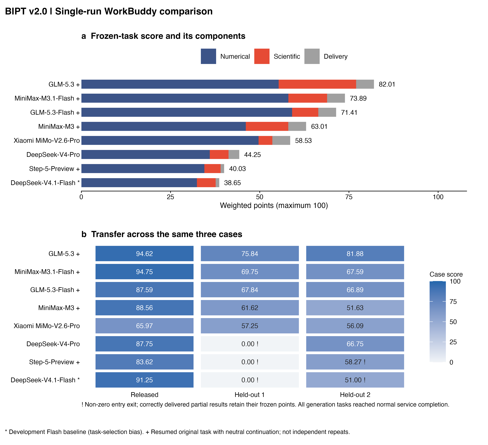
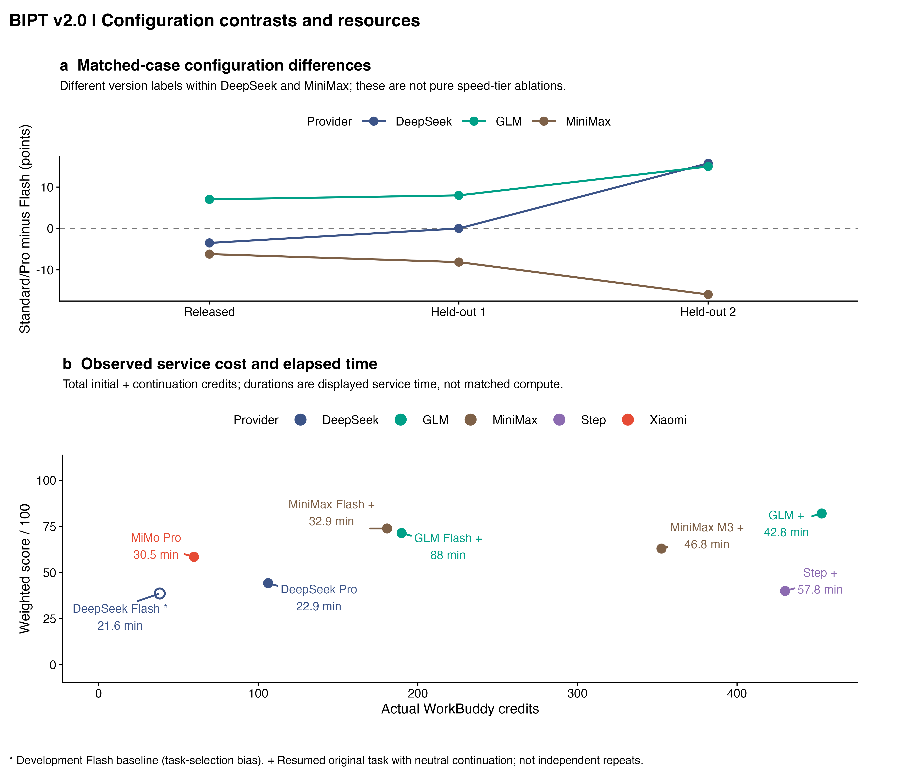
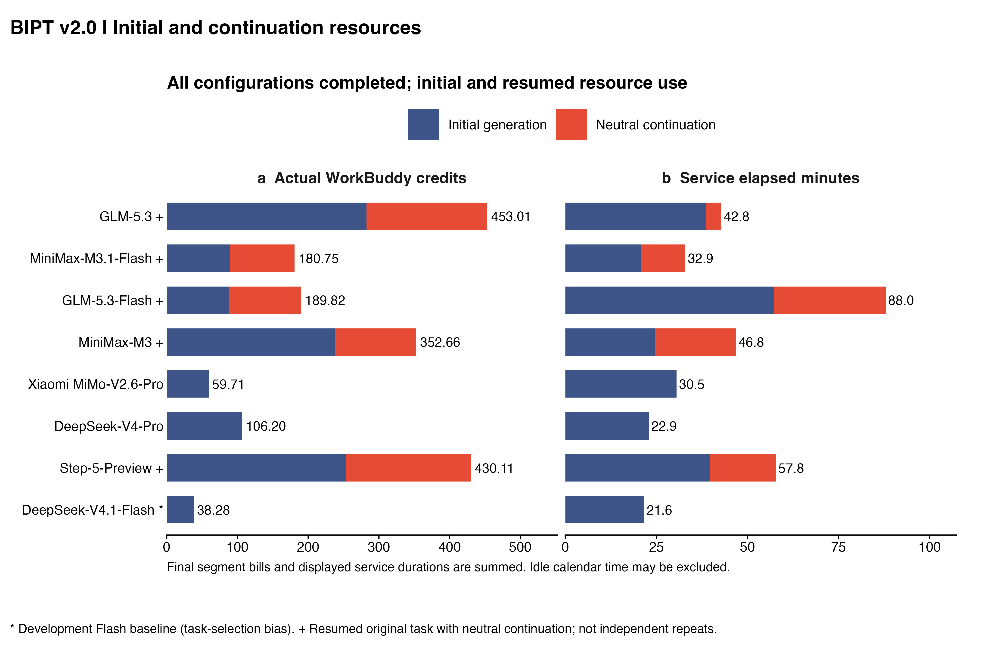

# BIPT v2.0 — observed results and interpretation

All 8 configurations have reached normal service completion and have final frozen scores. Five initially stopped tasks were resumed with the same neutral continuation instruction; these are marked with a plus sign. They are completions of the original generations, not independent new trials. The DeepSeek Flash development baseline is reused and marked with an asterisk.

**These are exact single-run observations on a selected synthetic task, not a statistically established general model ranking.** Version 1.0 scores use a different task and scale and are excluded.

## Scores and case transfer

| Configuration | Total / 100 | Numerical / 60 | Scientific / 35 | Delivery / 5 | Released | Held-out 1 | Held-out 2 |
|---|---:|---:|---:|---:|---:|---:|---:|
| GLM-5.3 + | 82.01 | 55.31 | 21.70 | 5.00 | 94.62 | 75.84 | 81.88 |
| MiniMax-M3.1-Flash + | 73.89 | 58.04 | 10.85 | 5.00 | 94.75 | 69.75 | 67.59 |
| GLM-5.3-Flash + | 71.41 | 59.06 | 7.35 | 5.00 | 87.59 | 67.84 | 66.89 |
| MiniMax-M3 + | 63.01 | 46.11 | 11.90 | 5.00 | 88.56 | 61.62 | 51.63 |
| Xiaomi MiMo-V2.6-Pro | 58.53 | 49.68 | 3.85 | 5.00 | 65.97 | 57.25 | 56.09 |
| DeepSeek-V4-Pro | 44.25 | 36.00 | 5.25 | 3.00 | 87.75 | 0.00 | 66.75 |
| Step-5-Preview + | 40.03 | 34.48 | 4.55 | 1.00 | 83.62 | 0.00 | 58.27 |
| DeepSeek-V4.1-Flash * | 38.65 | 32.40 | 5.25 | 1.00 | 91.25 | 0.00 | 51.00 |

Case totals are unweighted 100-point case scores; component columns are weighted across cases. The final total uses 20% released and 40% for each held-out case. Every generation is service-completed. A subsequent hidden replay can still fail and receive its actual frozen artifact points; entry failures are shown separately.

**Completion follow-up:** GLM standard/Flash, MiniMax standard/Flash and Step Preview were resumed after the user removed generation credit/time stops. Original chats, partial projects and model labels were preserved. No hidden feedback or scientific corrections were supplied. [Initial capped results](HISTORICAL_CAPPED_RESULTS.md) and [phase accounting](../../results/v2/execution_phases.csv) preserve that history. All three planned provider pairs now have final scores.

The highest observed completed total is 82.01 for GLM-5.3. This is conditional on this task, this submission and this rubric. Numerical correctness, scientific explanation and execution are separate outcomes; the component table is required to understand the total.

MiMo Pro exceeds DeepSeek Pro by 14.28 observed weighted points. Its released-case score is lower, but its original entry completes both hidden cases, whereas DeepSeek Pro fails one. MiMo's core protocol metrics and optimal mixtures transfer correctly across all three cases; its copied outer bounds and invalid or incomplete global certificates lose numerical points, while released-case prose reused in hidden reports loses scientific points. Completion and numerical transfer explain the difference more clearly than a broad claim about reasoning quality.

## Within-provider configuration comparisons

| Provider | Standard/Pro | Flash | Total difference (points) | Released difference | Held-out 1 difference | Held-out 2 difference |
|---|---|---|---:|---:|---:|---:|
| DeepSeek | DeepSeek-V4-Pro | DeepSeek-V4.1-Flash | +5.60 | -3.50 | +0.00 | +15.75 |
| GLM | GLM-5.3 | GLM-5.3-Flash | +10.60 | +7.03 | +8.00 | +14.98 |
| MiniMax | MiniMax-M3 | MiniMax-M3.1-Flash | -10.88 | -6.19 | -8.13 | -15.96 |

**DeepSeek component decomposition:** the +5.60 total-point difference comprises +3.60 numerical, +0.00 scientific and +2.00 delivery points. These are weighted components of this particular pair, not an estimated population effect.

**GLM component decomposition:** the +10.60 total-point difference comprises -3.75 numerical, +14.35 scientific and +0.00 delivery points. These are weighted components of this particular pair, not an estimated population effect.

**MiniMax component decomposition:** the -10.88 total-point difference comprises -11.93 numerical, +1.05 scientific and +0.00 delivery points. These are weighted components of this particular pair, not an estimated population effect.

Differences compare the same three fixed cases. They do not isolate a causal speed-tier effect: DeepSeek and MiniMax labels also differ in version, GLM standard has no Pro suffix, initial budgets and continuation histories differ, and the DeepSeek Flash result helped select task difficulty. No significance test or confidence interval is attached.

## Execution and resource observations

| Configuration | Status | Credits | Service minutes | Successful case exits |
|---|---|---:|---:|---:|
| DeepSeek-V4.1-Flash | completed_scored | 38.28 | 21.6 | 1/3 |
| DeepSeek-V4-Pro | completed_scored | 106.20 | 22.9 | 2/3 |
| GLM-5.3-Flash | completed_scored | 189.82 | 88.0 | 3/3 |
| GLM-5.3 | completed_scored | 453.01 | 42.8 | 3/3 |
| MiniMax-M3.1-Flash | completed_scored | 180.75 | 32.9 | 3/3 |
| MiniMax-M3 | completed_scored | 352.66 | 46.8 | 3/3 |
| Xiaomi MiMo-V2.6-Pro | completed_scored | 59.71 | 30.5 | 3/3 |
| Step-5-Preview | completed_scored | 430.11 | 57.8 | 1/3 |

Initial new comparison runs plus operator overhead consumed 1117.24 credits; the completion follow-up consumed 655.80; combined comparison cost is 1773.04. The reused Flash baseline's 38.28 credits belong to development and are outside that total. Operator overhead is 0.78 and excluded from model scores.

The user removed generation credit/time stops before the completion follow-up. No task was terminated to preserve the old allowance. These totals are observed bills, not an account balance or compute-matched budget. The optional Kimi run is outside this eight-configuration follow-up.

| Configuration | Initial credits | Continuation credits | Total credits | Initial service min | Continuation service min | Neutral messages |
|---|---:|---:|---:|---:|---:|---:|
| DeepSeek-V4.1-Flash | 38.28 | 0.00 | 38.28 | 21.6 | 0.0 | 0 |
| DeepSeek-V4-Pro | 106.20 | 0.00 | 106.20 | 22.9 | 0.0 | 0 |
| GLM-5.3-Flash | 87.40 | 102.42 | 189.82 | 57.3 | 30.7 | 2 |
| GLM-5.3 | 282.34 | 170.67 | 453.01 | 38.6 | 4.2 | 2 |
| MiniMax-M3.1-Flash | 89.91 | 90.84 | 180.75 | 20.8 | 12.1 | 1 |
| MiniMax-M3 | 238.02 | 114.64 | 352.66 | 24.7 | 22.1 | 1 |
| Xiaomi MiMo-V2.6-Pro | 59.71 | 0.00 | 59.71 | 30.5 | 0.0 | 0 |
| Step-5-Preview | 252.88 | 177.23 | 430.11 | 39.7 | 18.1 | 1 |

Only final segment bills are summed. Displayed service time can reset after a continuation and does not necessarily include all calendar waiting time. Both GLM configurations required a second identical neutral continuation after a cancelled segment; those segments are retained in cost accounting. No scientific feedback accompanied those messages.

At most two generation tasks overlap. Final scoring reruns remain serial with 360 seconds per case. [The original capped plan](../../results/v2/history_capped/comparison_plan.csv), [completion protocol](EVALUATION_PROTOCOL.md) and [phase table](../../results/v2/execution_phases.csv) distinguish generation resources from the unchanged evaluation rules.

## Scientific-error audit

The following summaries come from the fixed evaluator's case-specific item decisions. They distinguish missing reports, incomplete required evidence and explicit scientific contradictions. They do not imply a recurring error rate for the underlying model.

### GLM-5.3

- **Released:** numerical 58.125/60, scientific 31.5/35, delivery 5/5; entry exit 0. Correct event/count and shared-batch core; biological event definitions are incomplete. Correct structural-path core; required details for every invalid protocol are incomplete.
- **Held-out 1:** numerical 49.84/60, scientific 21/35, delivery 5/5; entry exit 0. The concrete denominator example and outer-relaxation comparison are false. Incorrectly declares positive baseline exposure and harm absent. The sampling explanation gives the wrong size for the second layer. Correct structural-path core; required details for every invalid protocol are incomplete. Correct optimization and ratio core; required conditional-rate case evidence is incomplete.
- **Held-out 2:** numerical 59.375/60, scientific 17.5/35, delivery 5/5; entry exit 0. The explanation falsely states that all types satisfy the support restriction. The stated zero-to-positive denominator example actually has denominator one. Incorrectly declares positive baseline exposure and harm absent. Without replacement does not prohibit two different members of the same type. Correct structural-path core; required details for every invalid protocol are incomplete. Correct optimization and ratio core; required conditional-rate case evidence is incomplete.

### MiniMax-M3.1-Flash

- **Released:** numerical 60/60, scientific 29.75/35, delivery 5/5; entry exit 0. Correct sampling and selection core; required numerical joint-enrollment denominator evidence is incomplete. The explanation incorrectly treats unchanged action order as unchanged read-path probabilities.
- **Held-out 1:** numerical 59.5/60, scientific 5.25/35, delivery 5/5; entry exit 0. The stated enumeration dimensions and per-layer candidate counts are wrong. Correct query and relaxation core; denominator-boundary explanation is incomplete. Incorrectly declares existing baseline exposure and harm absent. The concrete member-pair probabilities and cohort example do not match this case. Explains a strict common-panel advantage as single-protocol equality. Incorrectly denies the strict randomized-design gain shown by its own values. The explanation incorrectly treats unchanged action order as unchanged read-path probabilities. The reported certificate-violation evidence contradicts the claim of a valid global proof. The figure labels the utility with the wrong cost coefficient.
- **Held-out 2:** numerical 55.59/60, scientific 7/35, delivery 5/5; entry exit 0. The stated exhaustive-enumeration sizes and per-layer candidate counts are wrong. The stated case-specific outer-relaxation bounds and widening count are wrong. Incorrectly declares existing baseline exposure and harm absent. The concrete pair-sampling probabilities and observation-envelope interpretation are wrong. Explains a strict common-panel advantage as single-protocol equality. Incorrectly denies the strict randomized-design gain shown by its own values. The explanation incorrectly treats unchanged action order as unchanged read-path probabilities. The reported certificate-violation evidence contradicts the claim of a valid global proof.

### GLM-5.3-Flash

- **Released:** numerical 59.84/60, scientific 22.75/35, delivery 5/5; entry exit 0. Correct finite-panel core; actual residual/envelope evidence is incomplete. Correct biological and shared-batch core; actual joint-read comparison is incomplete. Correct sampling/selection core; numerical joint-enrollment and posterior evidence is incomplete. Correct common-panel core; required certificate-support evidence is incomplete. Correct optimization and ratio core; per-layer cap evidence is incomplete in the explanation. Correct cost/reset comparison; required structural path-cost explanation is incomplete. Correct tight-certificate core; original-observation residual and endpoint evidence is incomplete.
- **Held-out 1:** numerical 59.34/60, scientific 3.5/35, delivery 5/5; entry exit 0. Correct finite-panel core; actual residual/envelope evidence is incomplete. The concrete query and outer-bound examples are copied from another case. Incorrect biological exposure claim and nonexistent case-specific channel evidence. The enrollment and sampling examples do not belong to the supplied case. The explanation applies the wrong path-budget threshold. The common-panel comparison is incorrectly described as equal. Incorrectly denies strict randomization gain and calls an over-cap risk compliant. Incorrectly describes unequal reset-batch and persistent-batch values as equal. Correct tight-certificate core; original-observation residual and endpoint evidence is incomplete. The displayed utility coefficient does not match the supplied case.
- **Held-out 2:** numerical 58.3926/60, scientific 3.5/35, delivery 5/5; entry exit 0. The stated support assumption contradicts the supplied support table. The concrete denominator and outer-bound examples are copied from another case. Incorrect biological exposure claim and nonexistent case-specific channel evidence. The enrollment and sampling evidence uses the wrong cohorts and layer proportions. The explanation applies the wrong path-budget threshold. The common-panel comparison is incorrectly described as equal. Incorrectly denies strict randomization gain and calls an over-cap risk compliant. Correct cost/reset comparison; structural path-cost explanation is incomplete. Correct tight-certificate core; original-observation residual and endpoint evidence is incomplete. The displayed utility coefficient does not match the supplied case.

### MiniMax-M3

- **Released:** numerical 59.055/60, scientific 24.5/35, delivery 5/5; entry exit 0. Incorrectly claims that most queries widen under the outer relaxation. Correct biological and shared-batch core; actual joint-read evidence is incomplete. The stated enrollment posterior is wrong for a cohort with constant capture. The figure omits visible point-identified bounds for multiple query rows.
- **Held-out 1:** numerical 47.8733/60, scientific 8.75/35, delivery 5/5; entry exit 0. The enumeration and normalization explanation uses the wrong layer sizes. The denominator example and claimed relaxation widening are false. Incorrectly declares positive baseline exposure absent and conditional rates undefined. The sampling comparison and enrollment posterior are scientifically incorrect. Incorrectly denies randomization benefit and states an over-cap risk meets the cap. The conclusion contradicts the explicitly unequal diagnostic utilities. The robust certificate does not satisfy the claimed all-protocol inequality. The figure omits visible point-identified bounds for multiple query rows.
- **Held-out 2:** numerical 37.8751/60, scientific 8.75/35, delivery 5/5; entry exit 0. The enumeration and support explanation contradict the actual case. The denominator example and claimed majority of widened bounds are false. Incorrectly declares positive baseline exposure absent and conditional rates undefined. Incorrect pair-sampling probabilities and enrollment posterior. Incorrectly denies randomization benefit and states an over-cap risk meets the cap. The cited protocol has the wrong action sequence and cost in the explanation. The claimed physical witnesses and global proofs fail validation against the original case. The figure omits visible point-identified bounds for multiple query rows.

### Xiaomi MiMo-V2.6-Pro

- **Released:** numerical 48.715/60, scientific 12.25/35, delivery 5/5; entry exit 0. Correct finite-panel core; required residual and envelope evidence is incomplete. Incorrectly states that all outer-relaxation bounds equal the integer bounds. Correct shared-batch and event/count core; required biological and joint-read evidence is incomplete. Correct sampling core; ordered-cohort and selection-posterior evidence is incomplete. The explanation attributes an invalid protocol to the wrong structural violation. Correct common-panel information order; numerical comparison and certificate-support evidence is incomplete. Correct actual optimal values; risk, mixture-support and conditional-rate explanation is incomplete. The stated across-protocol cost range excludes the zero-cost STOP protocol. Correct public upper-bound core; complete vector-certificate evidence and required sides are incomplete. The figure omits required outer bounds, per-query undefined labels and actual risk quantities.
- **Held-out 1:** numerical 50.5/60, scientific 1.75/35, delivery 5/5; entry exit 0. Panel sizes and support assumptions in the explanation are from the released case. The concrete query and identification examples are copied from the released case. The claimed batch-channel example does not exist in the supplied case. The member-pair example refers to types absent from the supplied case. The prose uses the wrong path budget and structural violation description. The claimed number of feasible physical panels contradicts the case and its own summary. Correct actual optimal values; risk, mixture-support and conditional-rate explanation is incomplete. The stated across-protocol cost range is incorrect and the required diagnostic comparison is missing. The claimed global certificate violates the required all-protocol upper inequalities. The text states different safety limits from the actual input and plotted limits.
- **Held-out 2:** numerical 49.34/60, scientific 1.75/35, delivery 5/5; entry exit 0. Panel sizes and support assumptions in the explanation are from the released case. The concrete query and identification examples are copied from the released case. The claimed batch-channel example does not exist in the supplied case. The member-pair example refers to types absent from the supplied case. The prose uses the wrong path budget and structural violation description. The claimed number of feasible physical panels contradicts the case and its own summary. Correct actual optimal values; risk, mixture-support and conditional-rate explanation is incomplete. The stated across-protocol cost range is incorrect and the required diagnostic comparison is missing. The claimed global certificate violates the required all-protocol upper inequalities. The text states different safety limits from the actual input and plotted limits.

### DeepSeek-V4-Pro

- **Released:** numerical 60/60, scientific 22.75/35, delivery 5/5; entry exit 0. Correct identification/relaxation core; denominator and reachable-value evidence incomplete. Correct event/count and shared-batch definitions; actual channel/joint-read evidence incomplete. Correct sampling and selection definitions; joint-denominator and batch-posterior evidence incomplete. Explicit reset-batch example reports incorrect utility values. The safety probability threshold is drawn on a utility axis.
- **Held-out 1:** numerical 0/60, scientific 0/35, delivery 0/5; entry exit 1. No scientific report was delivered after the original entry failed.
- **Held-out 2:** numerical 60/60, scientific 1.75/35, delivery 5/5; entry exit 0. Population size, support and census explanation were copied from the released case. Correct identification core, but case-specific numerical examples are missing. The hidden case is incorrectly described as having no baseline-positive members or exposure. The claimed case observation records and cohorts do not exist in the supplied case. The scientific explanation names the wrong illegal protocols. The stated selected strategy and common-panel comparison contradict the delivered tables. Constrained and unconstrained optimality claims contradict the actual computed results. The cost and error-experiment numerical explanation is from the released case. The explanation reports different multipliers and bounds from its valid certificate. The safety probability threshold is drawn on a utility axis.

### Step-5-Preview

- **Released:** numerical 55.875/60, scientific 22.75/35, delivery 5/5; entry exit 0. The stated outer-relaxation sharp bounds are incorrect. Correct sampling/selection core; numerical joint-denominator and posterior evidence is incomplete. Unchanged biological action sets do not imply unchanged read-path probabilities. The figure incorrectly labels expected cost and utility as probabilities.
- **Held-out 1:** numerical 0/60, scientific 0/35, delivery 0/5; entry exit 1. No case-specific scientific report was delivered after the original entry failed.
- **Held-out 2:** numerical 58.2667/60, scientific 0/35, delivery 0/5; entry exit 1. No case-specific scientific report was delivered after the original entry failed.

### DeepSeek-V4.1-Flash — development baseline

- **Released:** numerical 60/60, scientific 26.25/35, delivery 5/5; entry exit 0. Incorrectly attributes wider same-member query bounds to mixing integer panels and to changing pair coupling at fixed member distribution. An explicit pooled-confirmation counterexample contradicts the actual event probabilities; correct mixture diagnostics do not cancel that false claim. Identified point bounds are invisible in the actual query plot because zero-length intervals have no point markers.
- **Held-out 1:** numerical 0/60, scientific 0/35, delivery 0/5; entry exit 1. No case-specific scientific report or required figure was delivered after the original hidden replay failed.
- **Held-out 2:** numerical 51/60, scientific 0/35, delivery 0/5; entry exit 1. No case-specific scientific report or required figure was delivered after the original hidden replay failed.

The [item-level review table](../../results/v2/scientific_review.csv) records all R01–R10 points. Missing hidden reports are not replaced by released-case prose. A correct non-unique mixture or certificate retains numerical credit; the same underlying scientific error is not deducted again under R10.

## Reading the outcome responsibly

The task separates successful numerical optimization from faithful scientific reporting and transfer to changed inputs. Case-to-case differences can reflect different structural requirements as well as robustness; three cases do not support a generalization-rate estimate. An apparent price/score trade-off in the resource figure is descriptive and is not a compute-controlled efficiency frontier.

The development process targeted lower Flash scores through harder scientific requirements, which introduces task-selection bias. Once frozen, every prospective configuration received the same files and prompt and the same evaluation rules. No post hoc scaling was used to force a requested score. The five resumed results additionally depend on partial original context and neutral follow-up messages. A future confirmatory study should use fresh undisclosed instances, uninterrupted prospective runs for every configuration and independent repeats and reviewers.

Read the full [limitations](LIMITATIONS.md), [scoring policy](TASK_AND_SCORING.md), [execution protocol](EVALUATION_PROTOCOL.md) and [provenance summary](../../results/v2/run_provenance.json) before reusing a rank or figure. The protected organizer package is required to rerun official hidden scoring. Public validation establishes published-artifact consistency, not an independent replication of scientific judgment.
