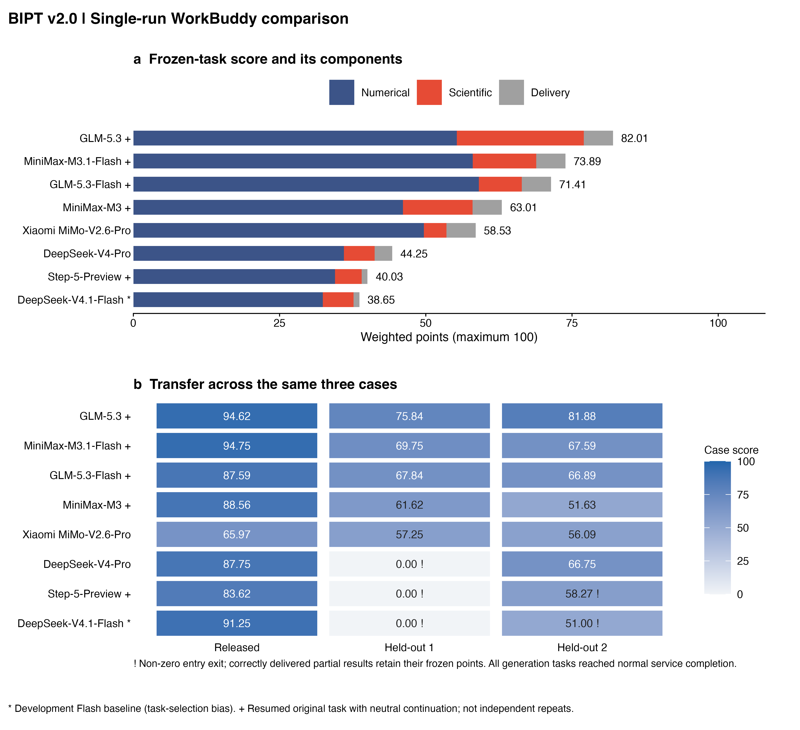
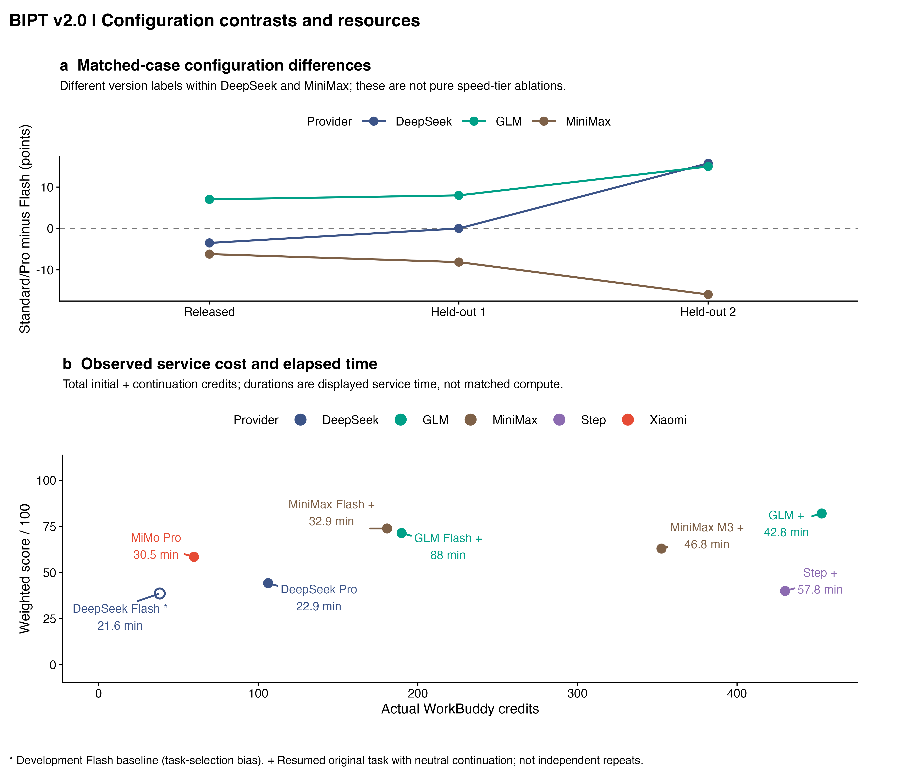
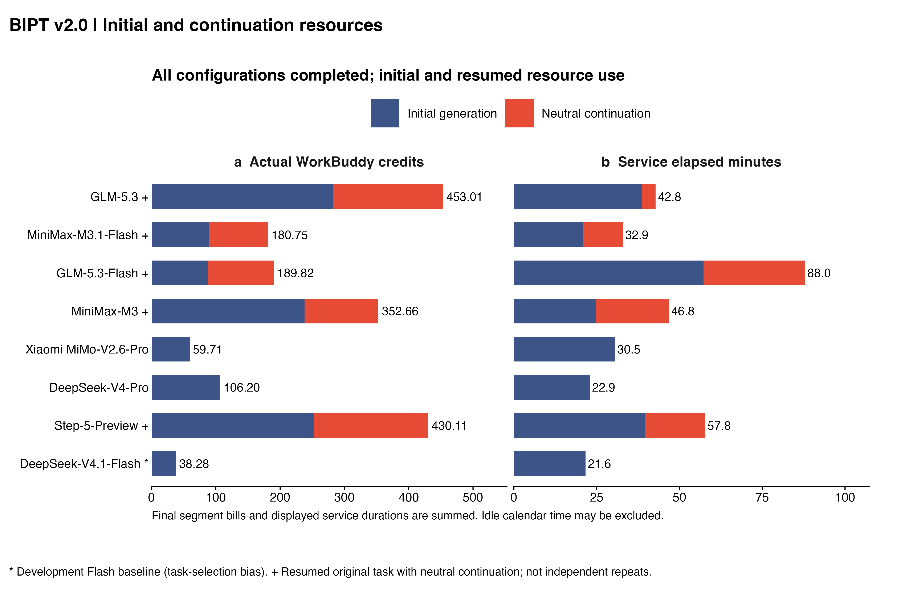

# BIPT v2.0 完整多模型实测分析

本轮八个配置都已正常完成模型生成，并使用冻结题目、同一评分程序和同一固定评估者完成评分。五个曾被外部积分限制中止的任务，在原会话继续完成，用“+”标记；DeepSeek Flash 是参与难度校准的开发基线，用“*”标记。继续完成不算新的独立重复试验。

## 完整成绩

| 配置 | 总分 /100 | 数值 /60 | 科学说明 /35 | 交付 /5 | 公开题 | 隐藏题1 | 隐藏题2 |
|---|---:|---:|---:|---:|---:|---:|---:|
| GLM-5.3 + | 82.01 | 55.31 | 21.70 | 5.00 | 94.62 | 75.84 | 81.88 |
| MiniMax-M3.1-Flash + | 73.89 | 58.04 | 10.85 | 5.00 | 94.75 | 69.75 | 67.59 |
| GLM-5.3-Flash + | 71.41 | 59.06 | 7.35 | 5.00 | 87.59 | 67.84 | 66.89 |
| MiniMax-M3 + | 63.01 | 46.11 | 11.90 | 5.00 | 88.56 | 61.62 | 51.63 |
| Xiaomi MiMo-V2.6-Pro | 58.53 | 49.68 | 3.85 | 5.00 | 65.97 | 57.25 | 56.09 |
| DeepSeek-V4-Pro | 44.25 | 36.00 | 5.25 | 3.00 | 87.75 | 0.00 | 66.75 |
| Step-5-Preview + | 40.03 | 34.48 | 4.55 | 1.00 | 83.62 | 0.00 | 58.27 |
| DeepSeek-V4.1-Flash * | 38.65 | 32.40 | 5.25 | 1.00 | 91.25 | 0.00 | 51.00 |

总分按公开题20%、两道隐藏题各40%加权。三列单题成绩都是各自100分制；数值、科学说明、交付列是加权后的组成。模型生成正常完成，不等于提交的程序在每道隐藏题都能正确运行；实际复跑退出状态另有记录。

## 同家族标准版/Pro 与 Flash

| 家族 | 标准版/Pro 减 Flash | 数值分差 | 科学分差 | 交付分差 |
|---|---:|---:|---:|---:|
| DeepSeek | +5.60 | +3.60 | +0.00 | +2.00 |
| GLM | +10.60 | -3.75 | +14.35 | +0.00 |
| MiniMax | -10.88 | -11.93 | +1.05 | +0.00 |

GLM 标准版相对 Flash 的优势主要来自科学说明，而非数值分更高：两者都能完成主要计算，但 Flash 的隐藏题正文仍大量沿用公开题结论。MiniMax 这次则是 Flash 的完整总分高于标准版，主要区别在数值转移、条件安全与证明材料的有效性。因此不能只用“更贵”或“Pro”标签推断本题成绩。

DeepSeek 与 MiniMax 配对的版本标签也不同，GLM 标准版在菜单中没有 Pro 后缀。这些是同家族配置对比，不是仅改变速度档位的因果实验。DeepSeek Flash 又是开发基线，存在题目选择偏倚。

## 科学错误怎样扣分

十项科学说明各3.5分：核心正确且本例证据齐全给3.5，核心正确但所需本例证据不全给1.75，明确科学错误给0。同一具体错误只计一次。正确表格不能抵消正文中相反的科学结论；有效的非唯一最优组合、物理见证或紧证书仍保留其数值分。

本轮常见失分包括：把隐藏题中的正暴露写成“全部没有暴露”；将已经严格增加的随机化效用写成“没有收益”；照搬公开题的样本数、查询或批次通道；把不相等的计算值解释为相等；以未通过原始约束的见证或证书主张全局证明。另一类仅是缺少所需证据，按半分处理，不升级成明确错误。逐项理由见[科学审查表](../../results/v2/scientific_review.csv)和[英文逐模型分析](RESULTS.md)。

## 完成过程与资源

五项继续任务使用同一条[中性继续指令](CONTINUATION_PROMPT.md)，没有向模型提供评分、隐藏输入、答案或科学纠错。原始中止项目和完成项目分别保留，参测输入与136项冻结文件没有改动。生成阶段取消外部积分/时间停止；评分阶段仍使用原来的每案例360秒复跑上限。

初始阶段与继续阶段的积分、服务显示时长及中性继续次数见[分阶段记录](../../results/v2/execution_phases.csv)。时长为界面显示的服务处理时长，不一定包含所有日历等待时间。只加总已结算的最终阶段账单，不把会跳动或重置的途中估算重复相加。

初始新比较（含操作开销）用分 1117.24，继续完成阶段 655.80，合计 1773.04。开发 Flash 的38.28分是此前开发用分，不计入这笔新比较费用；操作污染开销0.78分另计且不进入模型能力分。积分不是token或算力，不能把这里的费用曲线当作统一算力下的效率前沿。

## 结论边界

这些分数描述本次合成任务上的一次原始生成及其已披露继续过程。没有独立重复生成、显著性检验、置信区间或跨任务总体排名结论。题目曾按 Flash 表现迭代增难；冻结后没有为达到目标分数调整规则。科学说明35分依赖同一评估者的逐项判断，尚无独立评估者一致性证据。公开检查只能验证数据算术、文件和图表一致性；完整隐藏评分仍需私有组织者包。

[历史限额阶段](HISTORICAL_CAPPED_RESULTS.md)保留了当时五项未完成的事实；本次完整发布使用完成后的产物和分数。v1.0题目与评分体系不同，不能与v2.0合并排名。
